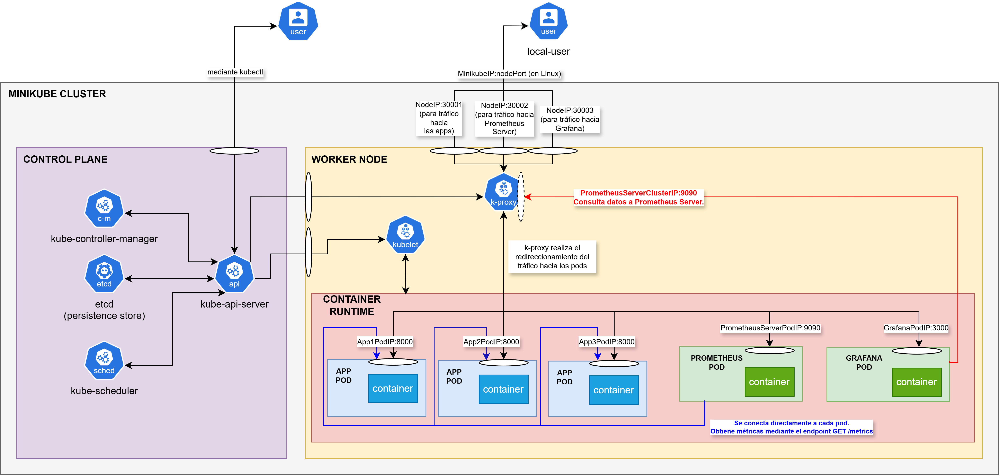
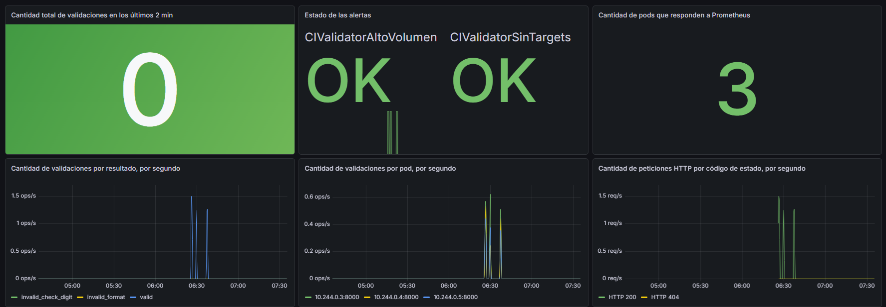
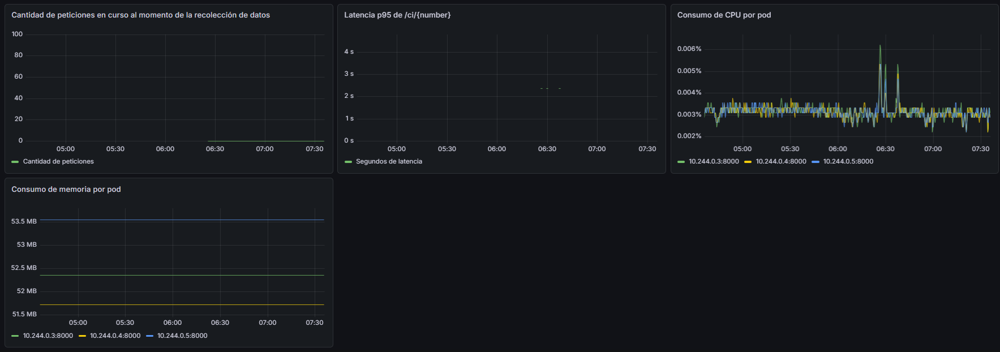
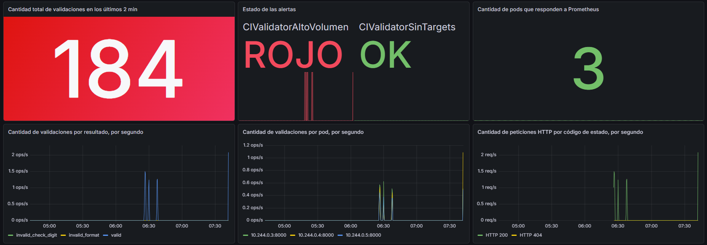
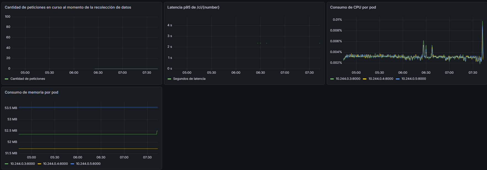
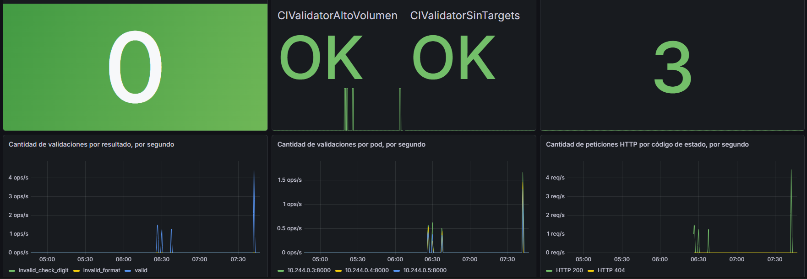
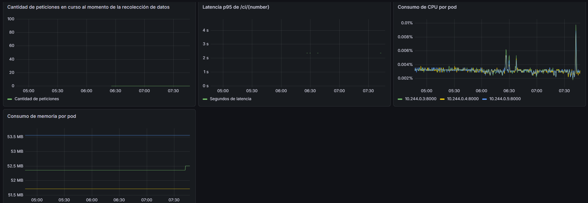

# Entregable 2 - Sistema de Monitoreo y Alertas para una Aplicación en Kubernetes

## Consigna

- Utilizando la aplicacion que crearon para el Entregable 1. Se deberá implementar un sistema de monitoreo y alertas si se pasa determinada cantidad de X operaciones en un período de Y minutos. Ejemplo: si se pasa determinada cantidad de órdenes de un producto en un período de 5 minutos. 
- La solución debe ser contenerizada y desplegada en un cluster de Kubernetes.
- Stack recomendado: Java, Springboot, Prometheus, Grafana

# Documentación

## Funcionalidad de la Aplicación

Ver [Entregable 1](entregable1.md)

## Stack Tecnológico

La aplicación utiliza:

- [FastAPI](https://fastapi.tiangolo.com/)
- [Uvicorn](https://uvicorn.dev/)

La aplicación es desplegada con:

- [Docker](https://www.docker.com/)
- [Kubernetes (k8s)](https://kubernetes.io/es/)
- [Minikube](https://minikube.sigs.k8s.io/docs/)

El sistema de monitoreo y alertas para la aplicación utiliza:

- [Prometheus](https://prometheus.io/docs/introduction/overview/)

    Prometheus es un sistema de código abierto enfocado en el monitoreo, almacenamiento y gestión de alertas, especializado en la recopilación de métricas en tiempo real.

    Sus características principales son:
    - Modelo de extracción (scraping): En lugar de que las aplicaciones envíen datos activamente, el servidor de Prometheus consulta (scrape) de forma periódica las métricas que exponen las aplicaciones.
    - Base de datos de series temporales: Almacena cada métrica asociada a un sello de tiempo (timestamp) y etiquetas en formato clave-valor.
    - PromQL: Cuenta con su propio lenguaje de consulta flexible para analizar, filtrar y procesar los datos numéricos acumulados.
    - Alertmanager: Prometheus evalúa de forma automatizada las reglas de alerta mediante consultas PromQL. Cuando una métrica supera un umbral (por ejemplo, el uso de CPU > 90%), dispara la alerta y se la envía a Alertmanager. Este es el módulo encargado de recibir las alertas generadas por Prometheus y gestionarlas (agruparlas, silenciarlas o enviarlas por canales como Slack, PagerDuty o correo).
    
    > **_Nota_** En este caso, no usaremos Alertmanager.

- [Grafana](https://grafana.com/docs/)

    Grafana es una plataforma de código abierto diseñada para la visualización analítica, el monitoreo visual y la consolidación multi-fuente de infraestructuras de TI y aplicaciones.

    Sus características princiales son:
    - Visualización de datos: Permite crear dashboards interactivos con gráficos de líneas, barras, mapas de calor e histogramas para ver el estado de servidores, uso de memoria, tráfico web o errores.
    - Conexión de múltiples fuentes: No almacena los datos por sí misma, sino que actúa como una interfaz unificada que consulta bases de datos y herramientas externas como Prometheus.
    - Sistema de alertas: Permite configurar notificaciones automáticas que se envían a canales como Slack, Telegram, Microsoft Teams o por correo electrónico cuando ocurre una anomalía o se supera un límite en el rendimiento.

## Sistema de Monitoreo y Alertas

Se utiliza:

- Prometheus para recopilar las métricas de las aplicaciones y los pods, y generar las alertas ([definidas aquí](../ci-validator-api/k8s-entregable2/monitoring/prometheus/configmap.yaml)).
- Grafana se encarga de la visualización de los datos que brinda Prometheus.
- La aplicación ([ci-validator-api v2.1.0](../ci-validator-api/v2.1.0/main.py)) expone un endpoint que responde con las métricas por defecto y las creadas por nosotros. La aplicación utiliza la librería prometheus-client para hacerlo.

### Arquitectura



### Métricas

Una métrica es un valor numérico cuantitativo que se recopila en tiempo real (o de forma periódica) para medir el rendimiento, el uso de recursos y el comportamiento de una aplicación, servidor o sistema operativo.

Las métricas están definidas en el [código de la aplicación](../ci-validator-api/v2.1.0/main.py).

En este caso, las métricas son:

- `ci_validator_validations_total{result}`
    - Tipo: Counter (contador)
    - Pregunta que responde: ¿Cuántas cédulas se validan y con qué resultado (válida, dígito verificador inválido, formato inválido)? La usa la alerta.
    - Dominio: Negocio

- `ci_validator_http_requests_total{method,route,status}`
    - Tipo: Counter
    - Pregunta que responde: ¿Cuántas peticiones llegan y cuántas fallan?
    - Dominio: Tráfico y errores

- `ci_validator_http_request_duration_seconds{method,route}`
    - Tipo: Histogram
    - Pregunta que responde: ¿Cuánto tarda en responder?	
    - Dominio: Latencia

- `ci_validator_http_requests_in_progress{method,route}`
    - Tipo: Gauge (cantidad que puede subir, bajar o establecerse arbitrariamente).
    - Pregunta que responde: ¿Cuántas peticiones se procesan ahora mismo?
    - Dominio: Saturación

- Las por defecto de prometheus_client de Python: ej. process_, python_gc_ (automáticas)
    - Tipo: Varios
    - Pregunta que responde: ¿Cuánta CPU y memoria consume el proceso?
    - Dominio: Saturación

> **_Nota_** El endpoint `/health` no se incluye en las métricas HTTP porque sesga el rendimiento de la aplicación (ej. haciendo parecer que la API es mucho más rápida, ya que `/health` responde en apenas un milisegundo); además, tampoco se incluye el endpoint `/metrics` porque Prometheus está periódicamente consultando. Ambos endpoints inflarían el tráfico medido, y diluirían la tasa de errores y la latencia agregadas.


## Comandos e Instrucciones para Probar el Sistema de Monitoreo y Alerta

### Comandos

```bash
=== MINIKUBE ===
# Para comenzar en limpio minikube.
minikube delete --all --purge

minikube start --driver=docker
minikube status

=== DOCKER (build de la imagen de la app) ===
docker build -f ./ci-validator-api/Dockerfile -t ci-validator-api:2.1.0 ./ci-validator-api/v2.1.0
docker images

=== CARGAR IMAGEN EN MINIKUBE ===
minikube image load ci-validator-api:2.1.0
minikube image ls

=== LEVANTAR APPS ===
kubectl apply -f ./ci-validator-api/k8s-entregable2/app-deployment.yaml -f ./ci-validator-api/k8s-entregable2/app-service.yaml
kubectl rollout status deployment/ci-validator-api

=== LEVANTAR PROMETHEUS ===
kubectl apply -f ./ci-validator-api/k8s-entregable2/monitoring/prometheus/
kubectl rollout status deployment/prometheus
# Demora al hacer pull de la imagen.

=== LEVANTAR GRAFANA ===
kubectl apply -f ./ci-validator-api/k8s-entregable2/monitoring/grafana/
kubectl rollout status deployment/grafana
# Demora al hacer pull de la imagen.

=== VER ESTADO ===
kubectl get deploy,svc,pods
kubectl logs deploy/ci-validator-api
kubectl logs deploy/prometheus
kubectl logs deploy/grafana

=== ACCESO DESDE LA MÁQUINA LOCAL (una terminal por cada uno) ===
# Estos comandos dan una URL del estilo http://localhost con un número de puerto aleatorio.
minikube service ci-validator-api --url     # http://localhost:X/docs
minikube service prometheus --url           # http://localhost:Y/targets
minikube service grafana --url              # http://localhost:Z  (admin/admin)

=== CREAR Y VER DASHBOARDS EN GRAFANA ==
# Crear el datasource y los dashboards en la interfaz web de Grafana, como se indica más abajo.

=== TRÁFICO === -> Dispara la alerta: más de X = 40 validaciones en un período de Y = 2 minutos.
1..100 | ForEach-Object { curl.exe -s -o NUL "http://localhost:X/ci/1.234.567-2"; Start-Sleep -Milliseconds 500 }

=== VER ALERTA ===
# Se ve en los dashboards, como se indica más abajo.

=== BORRAR TODO ===
minikube stop
minikube delete --all --purge
```

### Conectar Grafana con Prometheus

El datasource se crea desde la interfaz de Grafana:

Primero hay que entrar a http://localhost:Y e iniciar sesión con las credenciales por defecto de Grafana (admin/admin).

Antes de crear dashboards, Grafana necesita saber dónde está Prometheus:

1. En el menú lateral, entrar a Connections → View configured data sources → Add new data source y elegir Prometheus.
2. En Prometheus server URL escribir http://prometheus:9090. Es el nombre del Service de Prometheus más su port.
3. En la sección Interval behaviour, poner Scrape interval en 15s, el cual es el mismo intervalo de lectura de Prometheus (scrape interval). Grafana lo usa para calcular $__rate_interval más adelante.
4. Pulsar Save & test. Debe aparecer un mensaje de éxito indicando que pudo consultar la API de Prometheus.

### Creación de Dashboard y Paneles

1. Dashboards → Create dashboard.
2. Para cada panel: Add → Panel → Configure visualization, elegir el datasource Prometheus, cambiar de Builder a Code y pegar la consulta.
3. Elegir el tipo de visualización en el lado derecho, y realizar los ajustes detallados por panel que se mencionan más abajo.
4. Al terminar, guardar el dashboard.

> **_Nota_** Usar la lupa para buscar las opciones de la visualización. La leyenda de cada consulta se configura en el editor de consultas, debajo de la consulta: Options → Legend → Custom.

- Requisito: El datasource Prometheus debe tener Scrape interval en 15s, para que `$__rate_interval` funcione bien.

El archivo [dashboard.yaml](../ci-validator-api/k8s-entregable2/dashboard.yaml) contiene todos el dashboard configurado.

Estos son los paneles del dashboard:

- Cantidad total de validaciones en los últimos 2 min
    - Visualización: Stat | Unidad: Number | Decimales: 0
    - Consulta PromQL: `sum(increase(ci_validator_validations_total[2m]))`
    - Thresholds: verde como base y rojo desde 40, con el modo de color en background.
    - Muestra el valor que evalúa la alerta CIValidatorAltoVolumen: el total de validaciones de todos los pods y resultados en los últimos 2 minutos. El umbral del panel debe coincidir con el de la regla.
    - Utilidad: ver en tiempo real qué tan cerca está el tráfico del umbral de la alerta, para anticiparse antes de que se dispare. En la demostración, permite comprobar que la alerta se dispara justo cuando el valor supera el umbral.

- Estado de las alertas
    - Visualización: Stat | Text mode: Value and name
    - Consulta PromQL: `max by (alertname) (ALERTS{alertstate="firing"}) * 2 or max by (alertname) (ALERTS{alertstate="pending"}) or label_replace(vector(0), "alertname", "CIValidatorAltoVolumen", "", "") or label_replace(vector(0), "alertname", "CIValidatorSinTargets", "", "")`
    - Leyenda: `{{alertname}}`
    - Value mappings: 0 → "OK" (verde), 1 → "PENDIENTE" (naranja), 2 → "DISPARADA" (rojo), con el modo de color en background.
    - Devuelve una serie por alerta, con valor 0 (inactiva), 1 (pendiente) o 2 (disparada). Los nombres de las alertas están escritos en la consulta: si se agrega una regla, hay que agregar su `label_replace`.
    - Utilidad: saber de un vistazo si hay algún problema activo y en qué etapa está (pendiente o disparada), sin entrar a la interfaz de Prometheus.

- Cantidad de pods que responden a Prometheus
    - Visualización: Stat | Unidad: Number
    - Consulta PromQL: `sum(up{job="ci-validator-api"}) or vector(0)`
    - Cuenta los pods cuya última lectura de `/metrics` funcionó.
    - Utilidad: detectar si Prometheus dejó de ver algún pod (por una caída, un puerto mal configurado o un escalado) y confirmar que todas las réplicas están siendo monitoreadas. Muestra en tiempo real la causa de la alerta CIValidatorSinTargets.

- Cantidad de validaciones por resultado, por segundo
    - Visualización: Time series | Unidad: ops/s
    - Consulta PromQL: `sum by (result) (rate(ci_validator_validations_total[$__rate_interval]))`
    - Leyenda: `{{result}}`
    - `rate()` devuelve validaciones por segundo.
    - Utilidad: ver cómo evoluciona el uso de la API y su composición. Un aumento de `invalid_format` sugiere un cliente que envía datos mal construidos; una gran mayoría de `invalid_check_digit` (cerca del 90 %) puede indicar que alguien está recorriendo números de cédula.

- Cantidad de validaciones por pod, por segundo
    - Visualización: Time series | Unidad: ops/s
    - Consulta PromQL: `sum by (instance) (rate(ci_validator_validations_total[$__rate_interval]))`
    - Leyenda: `{{instance}}`
    - Cada serie es un pod, identificado por su IP y puerto.
    - Utilidad: verificar que el Service reparte la carga de forma pareja entre las réplicas, detectar un pod que no recibe tráfico (por ejemplo, porque no está listo) y observar el efecto de escalar.

- Cantidad de peticiones HTTP por código de estado, por segundo
    - Visualización: Time series | Unidad: requests/sec (rps)
    - Consulta PromQL: `sum by (status) (rate(ci_validator_http_requests_total[$__rate_interval]))`
    - Leyenda: `HTTP {{status}}`
    - No incluye `/health` ni `/metrics`. Las cédulas inválidas responden 200, así que los códigos de error corresponden a fallos HTTP reales: rutas inexistentes, métodos no permitidos o errores del servidor.
    - Utilidad: medir el tráfico HTTP total y detectar errores. Los 5xx indican fallos de la aplicación; los 404 indican clientes que usan rutas incorrectas o escaneos automáticos.

- Latencia p95 de /ci/{number}
    - Visualización: Time series | Unidad: seconds (s)
    - Consulta PromQL: `histogram_quantile(0.95, sum by (le) (rate(ci_validator_http_request_duration_seconds_bucket{route="/ci/{number}"}[$__rate_interval])))`
    - Leyenda: `Segundos de latencia`
    - Estimación del tiempo por debajo del cual está el 95 % de las peticiones a `/ci/{number}`, calculada a partir de los buckets del histograma. Sin tráfico no hay datos y el gráfico queda vacío.
    - Utilidad: saber si la API responde rápido para casi todos los usuarios y detectar una degradación (por falta de CPU o exceso de carga) antes de que se convierta en errores. Sirve de base para definir objetivos de servicio, por ejemplo "el 95 % de las validaciones tarda menos de 10 ms".

- Cantidad de peticiones en curso al momento de la recolección de datos
    - Visualización: Time series | Unidad: Number | Decimales: 0
    - Consulta PromQL: `sum(ci_validator_http_requests_in_progress)`
    - Leyenda: `Cantidad de peticiones`
    - Suele valer 0: las peticiones duran milisegundos y Prometheus lee cada 15 segundos.
    - Utilidad: detectar saturación. Si el valor crece y se mantiene alto, las peticiones se están acumulando, lo que indica que hacen falta más réplicas o más recursos.

- Consumo de memoria por pod
    - Visualización: Time series | Unidad: bytes(SI - Sistema Internacional -> potencias de 10)
    - Consulta PromQL: `process_resident_memory_bytes{job="ci-validator-api"}`
    - Leyenda: `{{instance}}`
    - Memoria residente de cada proceso, una métrica automática de `prometheus_client`.
    - Utilidad: detectar fugas de memoria (un crecimiento constante que nunca baja) y elegir los valores de `resources` del Deployment. Si se definen límites de memoria, permite anticipar que Kubernetes termine un pod por superarlos.

- Consumo de CPU por pod
    - Visualización: Time series | Unidad: Percent (0-100)
    - Consulta PromQL: `rate(process_cpu_seconds_total{job="ci-validator-api"}[$__rate_interval])`
    - Leyenda: `{{instance}}`
    - Fracción de un núcleo de CPU que usa cada proceso.
    - Utilidad: elegir los valores de CPU en `resources`, relacionar subidas de latencia con el uso de CPU y decidir cuándo escalar. Es la métrica que usaría un escalado automático (Horizontal Pod Autoscaler) en una versión futura.

### Test Simple

Test simple para comprobar que saltan las alertas y que el dashboard muestra los estados del sistema, ya sea el actual o pasados.

Así se ve el dashboard sin enviar nada de tráfico a la aplicación en este instante:





Al ejecutar en la terminal:

```bash
1..200 | ForEach-Object { curl.exe -s -o NUL "http://localhost:X/ci/1.234.567-2"; Start-Sleep -Milliseconds 100 }
```

Luego de unos pocos segundos, el dashboard reflejó el estado del sistema ante estrés:





Luego, al detenerse el tráfico, detectó que el sistema se estabilizó:



