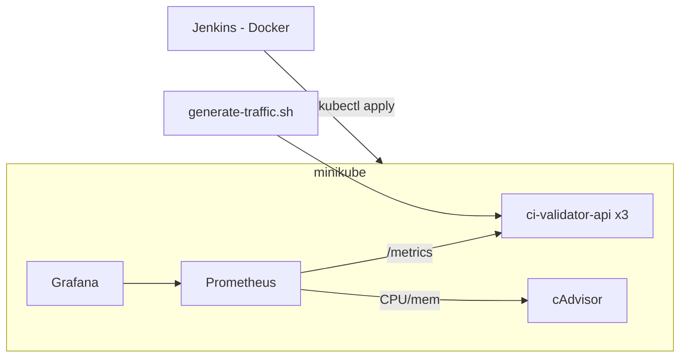

# Laboratorio 4: Trabajo integrador

## Objetivo general

El presente trabajo tiene como finalidad integrar los contenidos teóricos y prácticos del curso mediante la implementación completa de un proyecto con enfoque **DevOps** y **DevSecOps**.

Se debe tomar un proyecto existente y mejorar su arquitectura, seguridad, despliegue y monitoreo aplicando las herramientas vistas en el curso:

## Objetivos específicos


# Monitoreo y observabilidad (Prometheus + Grafana)
a. Se debe instrumentar la aplicación para exponer métricas accesibles por Prometheus.
b. Ejemplo: endpoint /metrics o integración mediante Micrometer o librerías equivalentes.
c. Se debe desplegar Prometheus en el cluster y configurar el scrape del servicio.
d. Se debe desplegar Grafana y conectarlo como fuente de datos a Prometheus.
e. Se debe crear un dashboard personalizado en Grafana que muestre, como mínimo:
a. Número de peticiones procesadas (RPS).
b. Latencia promedio de respuesta.
c. Uso de CPU y memoria por pod.
d. Una métrica de negocio relevante para la aplicación.
f. Se debe exportar el dashboard en formato .json y guardar el archivo en /grafana/dashboard.json.

Podés trabajar en estos archivos:
Jenkinsfile; está en la raíz del repo
todos los archivos de la carpeta /jenkins
todos los archivos de la carpeta /ci-validator-api/v2.1.1, menos el archivo main,py porque es el que tengo que corregir con el entregable 3 sus vulnerabilidades (no tocar)


### 6. Reporte técnico final

- **a.** Se debe generar un archivo `README.md` o informe PDF con los siguientes apartados:
  - **a.** Descripción general del proyecto.
  - **b.** Arquitectura final (con diagrama de componentes).
  - **c.** Pipeline implementado (etapas y herramientas).
  - **d.** Métricas y dashboard de Grafana.
  - **e.** Resultados de análisis de seguridad (Semgrep, Snyk, Kyverno, Falco).
  - **f.** Problemas encontrados y soluciones adoptadas.
  - **g.** Conclusiones generales y oportunidades de mejora.
- **b.** Se deben incluir capturas o fragmentos de salida de las herramientas principales.
- **c.** Se debe adjuntar el dashboard de Grafana exportado.

---

## Consideraciones adicionales

Para este entregable, se debe:

- **a)** Tener scripts de bash que se encarguen de inicializar, hacer solicitudes a la aplicación de manera automática para popular los dashboards, y borrar todos los recursos. También se debe incluir en estos comandos la instalación de operadores de Kubernetes.
- **b)** Tener scripts que inicien todos los componentes necesarios (Jenkins, Grafana, etc.).
- **c)** Tener documentación extensa que explique paso a paso qué comandos utilizar y los resultados que se obtuvieron en las etapas donde haya que visualizar resultados.

---

# Documentación del Entregable 4

## a. Descripción general

`ci-validator-api` (FastAPI) valida cédulas uruguayas y expone `/ci/{number}`, `/health` y `/metrics`. Se integra con Prometheus, Grafana (provisionado), un pipeline Jenkins y scripts que automatizan el ciclo completo en minikube.

## b. Arquitectura



Lo nuevo vive en `ci-validator-api/k8s-entregable4/` (reemplaza recursos de `k8s-entregable2/`, que no se modificó), `grafana/dashboard.json`, `jenkins/`, `Jenkinsfile` y `scripts/`.

## c. Pipeline

`Jenkinsfile` (parámetro `VERSION`, por defecto `2.1.1`): **Tests** (`pytest`) → **Build y carga en minikube** (`docker build`, `docker save | docker exec -i minikube docker load`) → **Deploy** (`scripts/deploy.sh`, espera el rollout).
El job lee el repo local (rama `feature/entregable4`): solo ve lo commiteado.

## Paso a paso

Requisitos: Docker Desktop, minikube, kubectl.

```bash
./scripts/init.sh                 # minikube, addon metrics-server, imagen y manifiestos
./scripts/start-components.sh     # Jenkins :8080, app :5000, Prometheus :9090, Grafana :3000
./scripts/generate-traffic.sh     # puebla el dashboard y dispara la alerta
./scripts/cleanup.sh [--all]      # borra todo (--all: también minikube)
```

| Verificación | Resultado esperado |
|---|---|
| `kubectl get pods` | 3 × `ci-validator-api`, `prometheus`, `grafana` en `Running` |
| http://localhost:9090/targets | jobs `ci-validator-api` y `cadvisor` en `UP` |
| http://localhost:3000 (admin/admin) | dashboard "CI Validator API - Entregable 4" con datos |
| http://localhost:9090/alerts | `CIValidatorAltoVolumen` en `Firing` |
| http://localhost:8080 (admin/admin) → `ci-validator-api` → Build with Parameters | etapas en verde |

(Agregar aquí capturas/salidas obtenidas.)

## d. Dashboard de Grafana

[`grafana/dashboard.json`](../grafana/dashboard.json): RPS, latencia promedio, CPU y memoria por pod (cAdvisor) y validaciones por resultado (métrica de negocio). Las consultas PromQL están en el JSON.

## e. Seguridad

Fuera del alcance de este entregable (ver entregable 3).

## f. Problemas y soluciones

- Jenkins (Docker) debe alcanzar minikube: kubeconfig aplanado con la IP de minikube y red Docker `minikube`.
- Sin CLI de minikube en Jenkins: la imagen se carga vía socket de Docker.
- CPU/memoria por pod: job `cadvisor` + permisos RBAC.
- Los ConfigMap no se recargan solos: `deploy.sh` reinicia Prometheus y Grafana.

## g. Conclusiones y mejoras

(Completar tras ejecutar.) Mejoras posibles: webhook de Git, registry de imágenes, kube-prometheus-stack, alertas a un canal externo.
