# Entregable 2 - Sistema de Monitoreo y Alertas para una Aplicación en Kubernetes

## Consigna

- Utilizando la aplicacion que crearon para el Entregable 1. Se deberá implementar un sistema de monitoreo y alertas si se pasa determinada cantidad de X operaciones en un período de Y minutos. Ejemplo: si se pasa determinada cantidad de órdenes de un producto en un período de 5 minutos. 
- La solución debe ser contenerizada y desplegada en un clúster de Kubernetes.
- Stack recomendado: Java, Springboot, Prometheus, Grafana

# Documentación

## Funcionalidad de la Aplicación

La API es la del [Entregable 1](../entregable1/README.md), en la versión v2.1.0. Las respuestas de `/health` y `/ci/{number}` son las mismas que en v2.0.0, con `api_version` igual a `2.1.0`. Cambios de esta versión:

- Nuevo endpoint `GET /metrics`, con las métricas en el formato de Prometheus. No aparece en `/docs`, porque se excluyó del esquema a propósito: es un endpoint de infraestructura.
- Un middleware mide todas las peticiones HTTP, salvo las de `/health` y `/metrics`.

## Stack Tecnológico

La aplicación utiliza:

- [FastAPI](https://fastapi.tiangolo.com/)
- [Uvicorn](https://uvicorn.dev/)

La aplicación es desplegada con:

- [Docker](https://www.docker.com/)
- [Kubernetes (k8s)](https://kubernetes.io/es/)
- [Minikube](https://minikube.sigs.k8s.io/docs/)

El sistema de monitoreo y alertas para la aplicación utiliza:

- [Prometheus](https://prometheus.io/docs/introduction/overview/)

    Prometheus es un sistema de código abierto enfocado en el monitoreo, almacenamiento y gestión de alertas, especializado en la recopilación de métricas en tiempo real.

    Sus características principales son:
    - Modelo de extracción (scraping): En lugar de que las aplicaciones envíen datos activamente, el servidor de Prometheus consulta (scrape) de forma periódica las métricas que exponen las aplicaciones.
    - Base de datos de series temporales: Almacena cada métrica asociada a un sello de tiempo (timestamp) y etiquetas en formato clave-valor.
    - PromQL: Cuenta con su propio lenguaje de consulta flexible para analizar, filtrar y procesar los datos numéricos acumulados.
    - Alertmanager: Prometheus evalúa de forma automatizada las reglas de alerta mediante consultas PromQL. Cuando una métrica supera un umbral (por ejemplo, el uso de CPU > 90%), dispara la alerta y se la envía a Alertmanager. Este es el módulo encargado de recibir las alertas generadas por Prometheus y gestionarlas (agruparlas, silenciarlas o enviarlas por canales como Slack, PagerDuty o correo).
    
    > **_Nota_** En este caso, no usaremos Alertmanager porque solo generamos alertas, pero no las acciones cuando se disparan.

- [Grafana](https://grafana.com/docs/)

    Grafana es una plataforma de código abierto diseñada para la visualización analítica, el monitoreo visual y la consolidación multi-fuente de infraestructuras de TI y aplicaciones.

    Sus características principales son:
    - Visualización de datos: Permite crear dashboards interactivos con gráficos de líneas, barras, mapas de calor e histogramas para ver el estado de servidores, uso de memoria, tráfico web o errores.
    - Conexión de múltiples fuentes: No almacena los datos por sí misma, sino que actúa como una interfaz unificada que consulta bases de datos y herramientas externas como Prometheus.
    - Sistema de alertas: Permite configurar notificaciones automáticas que se envían a canales como Slack, Telegram, Microsoft Teams o por correo electrónico cuando ocurre una anomalía o se supera un límite en el rendimiento.

## Sistema de Monitoreo y Alertas

Se utiliza:

- Prometheus para consultar y guardar las métricas de los pods, y generar las [alertas que definimos en ConfigMap](./k8s/monitoring/prometheus/configmap.yaml).
- Grafana se encarga de la visualización de los datos que brinda Prometheus.
- La aplicación ([ci-validator-api v2.1.0](../ci-validator-api/v2.1.0/main.py)) expone un endpoint que responde con las métricas por defecto y las creadas por nosotros. La aplicación utiliza la librería [prometheus-client](https://pypi.org/project/prometheus-client/) para hacerlo.

### Arquitectura

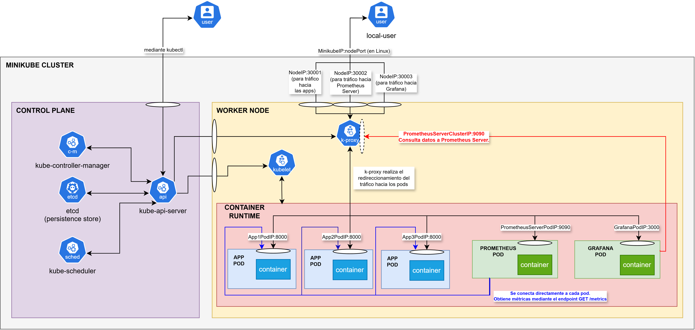
> **_Nota_** Véase los [manifiestos k8s del entregable 2](./k8s/) para entender la arquitectura.

### Métricas

Una métrica es un valor numérico cuantitativo que se recopila en tiempo real (o de forma periódica) para medir el rendimiento, el uso de recursos y el comportamiento de una aplicación, servidor o sistema operativo.

Las métricas que creamos están definidas en el [código de la aplicación](../ci-validator-api/v2.1.0/main.py), mientras que las por defecto están definidas en la librería de prometheus-client.

En este caso, las métricas son:

- `ci_validator_validations_total{result}`
    - Tipo: Counter (contador)
    - Pregunta que responde: ¿Cuántas cédulas se validan y con qué resultado (válida, dígito verificador inválido, formato inválido)? La usa la alerta.
    - Dominio: Negocio

- `ci_validator_http_requests_total{method,route,status}`
    - Tipo: Counter
    - Pregunta que responde: ¿Cuántas peticiones llegan y cuántas fallan?
    - Dominio: Tráfico y errores

- `ci_validator_http_request_duration_seconds{method,route}`
    - Tipo: Histogram
    - Pregunta que responde: ¿Cuánto tarda en responder?	
    - Dominio: Latencia
    - Buckets (límites superiores, en segundos): de `0.0005` a `0.25` (0,5ms - 1,0ms - 1,5ms - 2,0ms - 3,0ms - 5,0ms - 10ms - 25ms - 50ms - 100ms - 250ms).

- `ci_validator_http_requests_in_progress{method,route}`
    - Tipo: Gauge (cantidad que puede subir, bajar o establecerse arbitrariamente).
    - Pregunta que responde: ¿Cuántas peticiones se procesan ahora mismo?
    - Dominio: Saturación

- Las por defecto de prometheus_client de Python: ej. process_, python_gc_ (automáticas)
    - Tipo: Varios
    - Pregunta que responde: ¿Cuánta CPU y memoria consume el proceso?
    - Dominio: Saturación

> **_Nota_** El endpoint `/health` no se incluye en las métricas HTTP porque sesga el rendimiento de la aplicación (ej. haciendo parecer que la API es mucho más rápida, ya que `/health` responde en apenas un milisegundo); además, tampoco se incluye el endpoint `/metrics` porque Prometheus está periódicamente consultando. Ambos endpoints inflarían el tráfico medido, y diluirían la tasa de errores y la latencia agregadas.

## Comandos e Instrucciones para Probar el Sistema de Monitoreo y Alerta

### Comandos

Los siguientes comandos fueron ejecutados en PowerShell (>v6.0):

```bash
# Todos los comandos se ejecutan desde la raíz del repositorio.
# Se usan cuatro terminales: 1 (principal) y 2, 3 y 4 (túneles a la app, Prometheus y Grafana).

=== MINIKUBE ===
# Para comenzar en limpio minikube.
minikube delete --all --purge

minikube start --driver=docker
minikube status

=== DOCKER (build de la imagen de la app) ===
docker build -t ci-validator-api:2.1.0 ./ci-validator-api/v2.1.0
docker images

=== CARGAR IMAGEN EN MINIKUBE ===
minikube image load ci-validator-api:2.1.0
minikube image ls

=== LEVANTAR APPS (3 réplicas) ===
kubectl apply -f ./entregable2/k8s/app
kubectl rollout status deployment/ci-validator-api

=== LEVANTAR PROMETHEUS ===
kubectl apply -f ./entregable2/k8s/monitoring/prometheus/
kubectl rollout status deployment/prometheus
# La primera vez demora por la descarga de la imagen.

=== LEVANTAR GRAFANA ===
kubectl apply -f ./entregable2/k8s/monitoring/grafana/
kubectl rollout status deployment/grafana
# La primera vez demora por la descarga de la imagen.

=== VER ESTADO ===
kubectl get deploy,svc,pods
kubectl logs deploy/ci-validator-api
kubectl logs deploy/prometheus
kubectl logs deploy/grafana

=== ACCESO DESDE LA MÁQUINA LOCAL (una terminal por cada uno) ===
# Estos comandos dan una URL del estilo http://localhost con un número de puerto aleatorio.
minikube service ci-validator-api --url     # http://localhost:X/docs
minikube service prometheus --url           # http://localhost:Y/targets
minikube service grafana --url              # http://localhost:Z  (admin/admin)

=== CREAR Y VER DASHBOARDS EN GRAFANA ==
# Crear el datasource y los dashboards en la interfaz web de Grafana, como se indica más abajo.

=== DISPARAR ALERTAS ===

# Dispara la alerta: más de X = 40 validaciones en un período de Y = 2 minutos.
1..200 | ForEach-Object { curl.exe -s -o NUL "http://localhost:X/ci/1.234.567-2"; Start-Sleep -Milliseconds 50 }

# Opcional: generar errores 404 para el panel de códigos HTTP.
1..30 | ForEach-Object { curl.exe -s -o NUL "http://localhost:X/ruta-inexistente"; Start-Sleep -Milliseconds 50 }

# Reducir cantidad de pods a 0. Si se mantiene por 1 minuto: dispara la alerta que avisa que Prometheus no logra leer ningún pod de la app.
kubectl scale deployment/ci-validator-api --replicas=0

# Volver a la normalidad.
kubectl scale deployment/ci-validator-api --replicas=3

=== VER ALERTAS ===
# Se ve en los dashboards, como se indica más abajo.
# En Prometheus: http://localhost:Y/alerts
# En Grafana: panel "Estado de las alertas".

=== BORRAR TODO ===
minikube stop
minikube delete --all --purge
```

### Datasource de Prometheus

El datasource se crea automáticamente al iniciar Grafana. Está definido en [datasource-configmap.yaml](./k8s/monitoring/grafana/datasource-configmap.yaml): UID fijo `prometheus`, URL `http://prometheus:9090` (nombre y puerto del Service de Prometheus) y Scrape interval de 15 s, el mismo `scrape_interval` del [ConfigMap de Prometheus](./k8s/monitoring/prometheus/configmap.yaml). Grafana usa ese valor para calcular `$__rate_interval`.

Para verificarlo: Connections → Data sources → Prometheus → Save & test.

### Importar el dashboard

Dashboards → New → Import → subir el archivo del dashboard → Import.

Estos son los paneles del dashboard que creamos:

- Cantidad total de validaciones en los últimos 2 min
    - Visualización: Stat | Unidad: Number | Decimales: 0
    - Consulta PromQL: `sum(increase(ci_validator_validations_total[2m]))`
    - Thresholds: verde como base y rojo desde 40, con el modo de color en background.
    - Muestra el valor que evalúa la alerta CIValidatorAltoVolumen: el total de validaciones de todos los pods y resultados en los últimos 2 minutos. El umbral del panel debe coincidir con el de la regla.
    - Utilidad: ver en tiempo real qué tan cerca está el tráfico del umbral de la alerta, para anticiparse antes de que se dispare. En la demostración, permite comprobar que la alerta se dispara justo cuando el valor supera el umbral.

- Estado de las alertas
    - Visualización: Stat | Text mode: Value and name
    - Consulta PromQL: `max by (alertname) (ALERTS{alertstate="firing"}) * 2 or max by (alertname) (ALERTS{alertstate="pending"}) or label_replace(vector(0), "alertname", "CIValidatorAltoVolumen", "", "") or label_replace(vector(0), "alertname", "CIValidatorSinTargets", "", "")`
    - Leyenda: `{{alertname}}`
    - Value mappings: 0 → "OK" (verde), 1 → "PENDIENTE" (naranja), 2 → "DISPARADA" (rojo), con el modo de color en background.
    - Devuelve una serie por alerta, con valor 0 (inactiva), 1 (pendiente) o 2 (disparada). Los nombres de las alertas están escritos en la consulta: si se agrega una regla, hay que agregar su `label_replace`.
    - Utilidad: saber de un vistazo si hay algún problema activo y en qué etapa está (pendiente o disparada), sin entrar a la interfaz de Prometheus.

- Cantidad de pods que responden a Prometheus
    - Visualización: Stat | Unidad: Number
    - Consulta PromQL: `sum(up{job="ci-validator-api"}) or vector(0)`
    - Cuenta los pods cuya última lectura de `/metrics` funcionó.
    - Utilidad: detectar si Prometheus dejó de ver algún pod (por una caída, un puerto mal configurado o un escalado) y confirmar que todas las réplicas están siendo monitoreadas. Muestra en tiempo real la causa de la alerta CIValidatorSinTargets.

- Cantidad de validaciones por resultado, por segundo
    - Visualización: Time series | Unidad: ops/s
    - Consulta PromQL: `sum by (result) (rate(ci_validator_validations_total[$__rate_interval]))`
    - Leyenda: `{{result}}`
    - `rate()` devuelve validaciones por segundo.
    - Utilidad: ver cómo evoluciona el uso de la API y su composición. Un aumento de `invalid_format` sugiere un cliente que envía datos mal construidos; una gran mayoría de `invalid_check_digit` (cerca del 90 %) puede indicar que alguien está recorriendo números de cédula.

- Cantidad de validaciones por pod, por segundo
    - Visualización: Time series | Unidad: ops/s
    - Consulta PromQL: `sum by (instance) (rate(ci_validator_validations_total[$__rate_interval]))`
    - Leyenda: `{{instance}}`
    - Cada serie es un pod, identificado por su IP y puerto.
    - Utilidad: verificar que el Service reparte la carga de forma pareja entre las réplicas, detectar un pod que no recibe tráfico (por ejemplo, porque no está listo) y observar el efecto de escalar.

- Cantidad de peticiones HTTP por código de estado, por segundo
    - Visualización: Time series | Unidad: requests/sec (rps)
    - Consulta PromQL: `sum by (status) (rate(ci_validator_http_requests_total[$__rate_interval]))`
    - Leyenda: `HTTP {{status}}`
    - No incluye `/health` ni `/metrics`. Las cédulas inválidas responden 200, así que los códigos de error corresponden a fallos HTTP reales: rutas inexistentes, métodos no permitidos o errores del servidor.
    - Utilidad: medir el tráfico HTTP total y detectar errores. Los 5xx indican fallos de la aplicación; los 404 indican clientes que usan rutas incorrectas o escaneos automáticos.

- Latencia promedio de /ci/{number}
    - Visualización: Time series | Unidad: milliseconds (ms)
    - Consulta PromQL: `sum(rate(ci_validator_http_request_duration_seconds_sum{route="/ci/{number}"}[$__rate_interval])) / sum(rate(ci_validator_http_request_duration_seconds_count{route="/ci/{number}"}[$__rate_interval])) * 1000`
    - Leyenda: `Milisegundos de latencia`
    - Tiempo promedio de respuesta de `/ci/{number}`, considerando todos los pods: el tiempo total de las peticiones (`_sum`) dividido por la cantidad de peticiones (`_count`). Se suma antes de dividir, para que cada pod pese según la cantidad de peticiones que atendió. La métrica se mide en segundos, como recomienda la convención de Prometheus, y la consulta multiplica el resultado por 1000 para mostrarlo en milisegundos. A diferencia de un percentil, el promedio es exacto, porque no depende de los buckets. Sin tráfico, la división es 0/0 y el gráfico queda vacío.
    - Utilidad: ver cuánto tarda la API en responder y detectar una degradación (por falta de CPU o exceso de carga) antes de que se convierta en errores. El promedio no muestra las peticiones lentas cuando son pocas: si el 10 % tarda 200 ms y el resto 1 ms, el promedio es de unos 21 ms.

- Cantidad de peticiones en curso al momento de la recolección de datos
    - Visualización: Time series | Unidad: Number | Decimales: 0
    - Consulta PromQL: `sum(ci_validator_http_requests_in_progress)`
    - Leyenda: `Cantidad de peticiones`
    - Suele valer 0: las peticiones duran milisegundos y Prometheus lee cada 15 segundos.
    - Utilidad: detectar saturación. Si el valor crece y se mantiene alto, las peticiones se están acumulando, lo que indica que hacen falta más réplicas o más recursos.

- Consumo de memoria por pod
    - Visualización: Time series | Unidad: bytes(SI - Sistema Internacional -> potencias de 10)
    - Consulta PromQL: `process_resident_memory_bytes{job="ci-validator-api"}`
    - Leyenda: `{{instance}}`
    - Memoria residente de cada proceso, una métrica automática de `prometheus_client`.
    - Utilidad: detectar fugas de memoria (un crecimiento constante que nunca baja) y elegir los valores de `resources` del Deployment. Si se definen límites de memoria, permite anticipar que Kubernetes termine un pod por superarlos.

- Consumo de CPU por pod
    - Visualización: Time series | Unidad: Percent (0.0-1.0)
    - Consulta PromQL: `rate(process_cpu_seconds_total{job="ci-validator-api"}[$__rate_interval])`
    - Leyenda: `{{instance}}`
    - Fracción de un núcleo de CPU que usa cada proceso: 0,02 equivale al 2 % de un núcleo. Por eso la unidad es Percent (0.0-1.0), que multiplica el valor por 100 al mostrarlo; con Percent (0-100), 0,02 se mostraría como 0,02 %.
    - Utilidad: elegir los valores de CPU en `resources`, relacionar subidas de latencia con el uso de CPU y decidir cuándo escalar. Es la métrica que usaría un escalado automático (Horizontal Pod Autoscaler) en una versión futura.

### Test Simple

Test simple para comprobar que saltan las alertas y que el dashboard muestra los estados del sistema, ya sea el actual o pasados.

Así se ve sin enviar nada de tráfico a la aplicación en este instante:

En Prometheus:

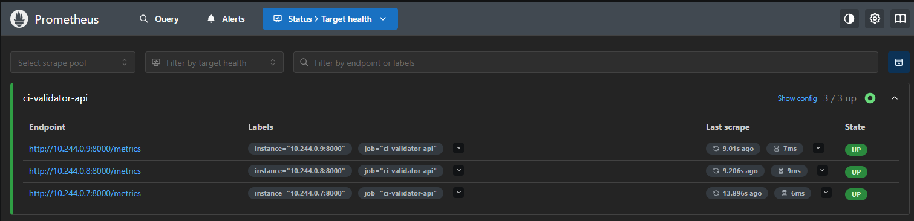

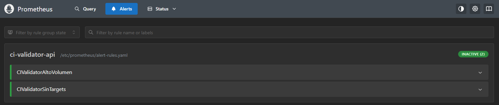

En Grafana:

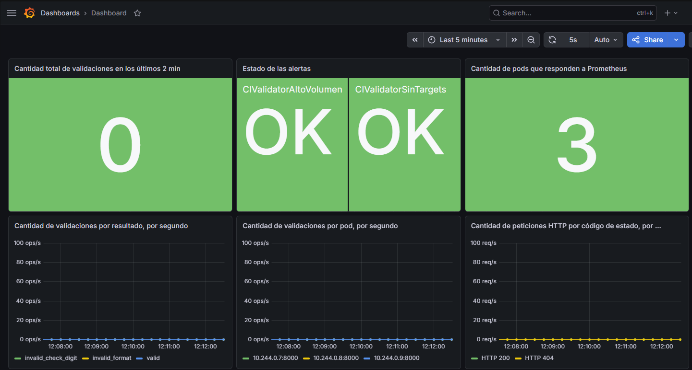

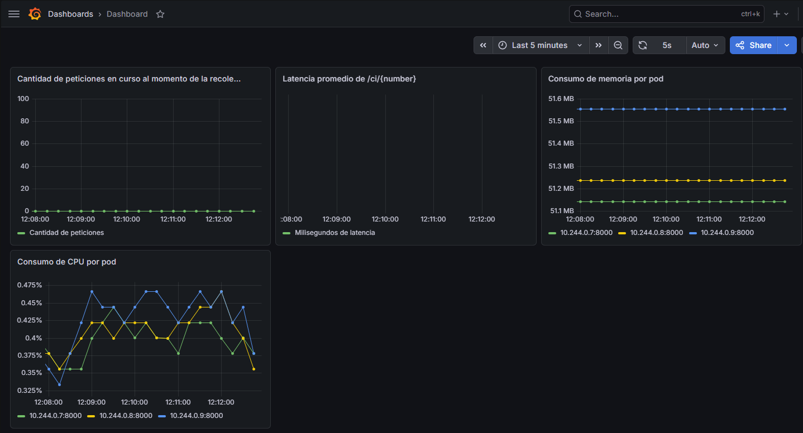

Al ejecutar en la terminal (cambiar la X por el puerto que se haya brindado anteriormente):

```bash
1..200 | ForEach-Object { curl.exe -s -o NUL "http://localhost:X/ci/1.234.567-2"; Start-Sleep -Milliseconds 50 }
1..30 | ForEach-Object { curl.exe -s -o NUL "http://localhost:X/ruta-inexistente"; Start-Sleep -Milliseconds 50 }
```

Luego de unos pocos segundos (15s), se reflejó el estado del sistema ante estrés y se mostró que se generó una alerta:

En Prometheus:

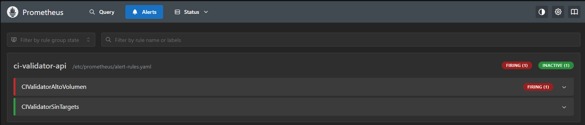

En Grafana:

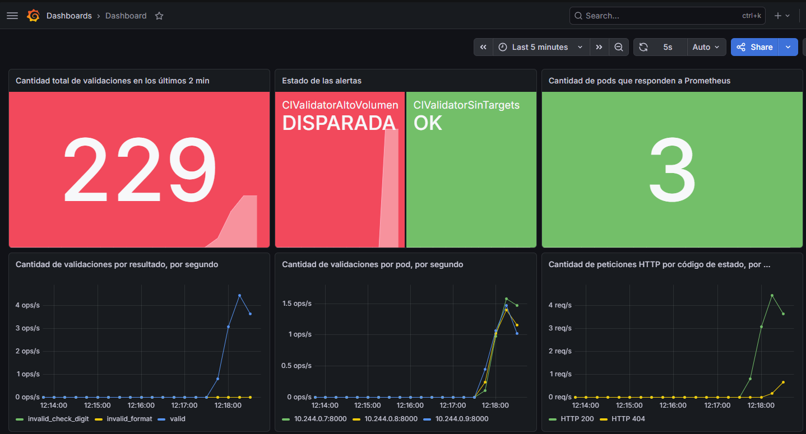

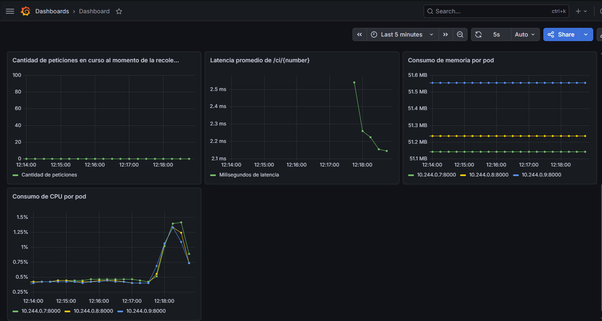

Luego, al detenerse el tráfico, se detectó que el sistema se estabilizó y que no había ninguna alerta disparada:

En Prometheus:

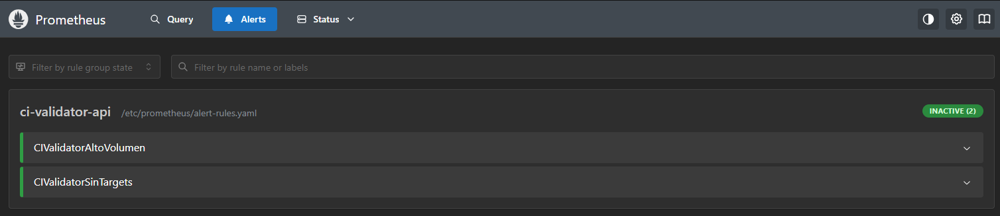

En Grafana:

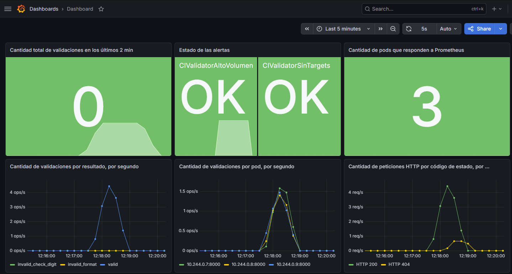

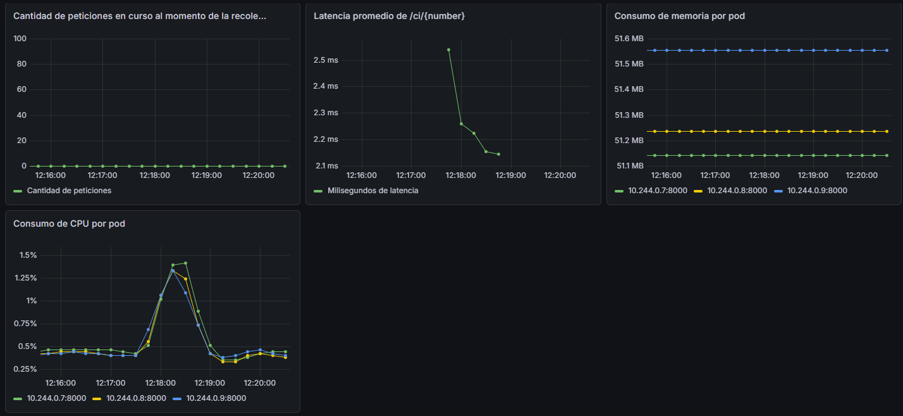

Al ejecutar en la terminal:

```bash
kubectl scale deployment/ci-validator-api --replicas=0
```

Luego de unos pocos segundos (15s), se reflejó el estado del sistema y se mostró que se generó una alerta (en estado pendiente porque no pasó 1min):

En Prometheus:

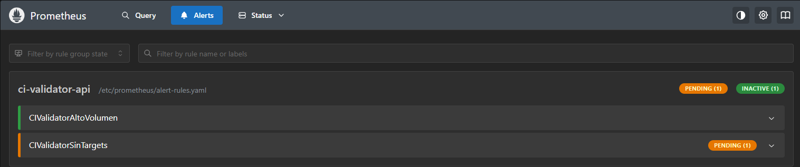

En Grafana:

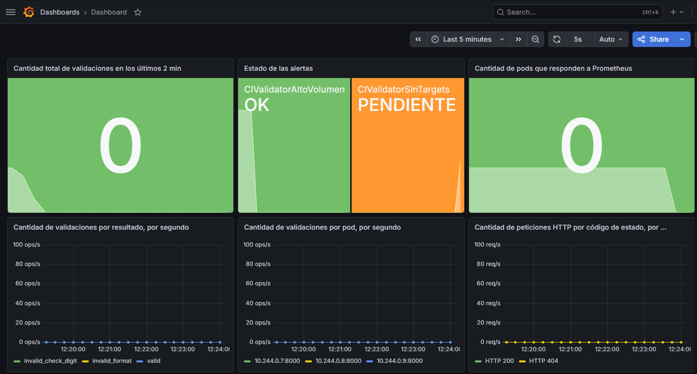

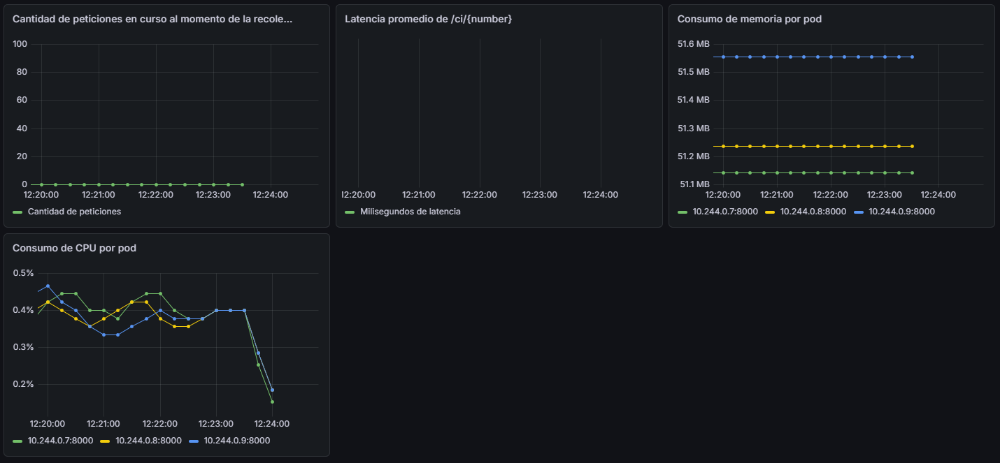

Luego de 1min se disparó la alerta:

En Prometheus:

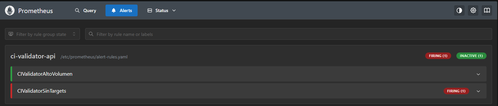

En Grafana:

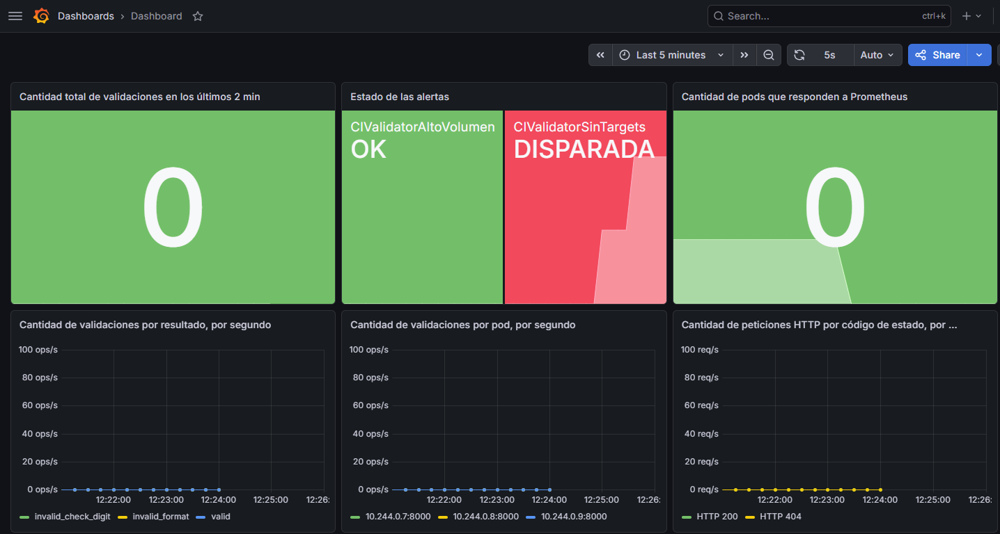

Al ejecutar en la terminal:

```bash
kubectl scale deployment/ci-validator-api --replicas=3
```

Luego de unos pocos segundos (15s), se reflejó el estado del sistema y se mostró que no se disparó la alerta, ya que el sistema regresó a la normalidad:

En Prometheus:

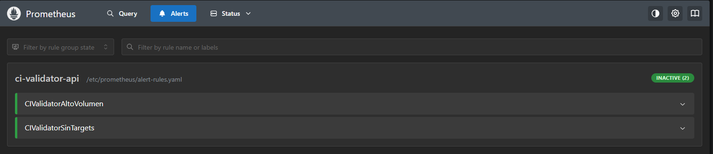

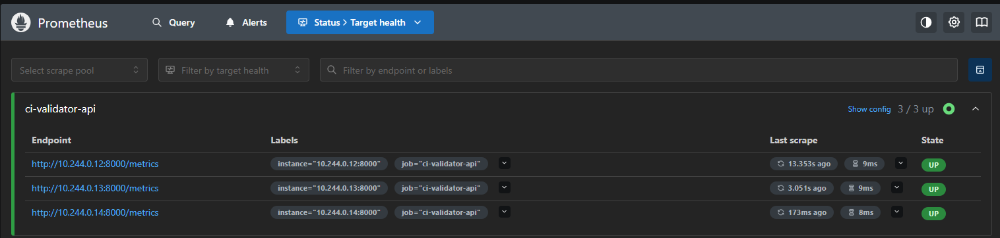

En Grafana:

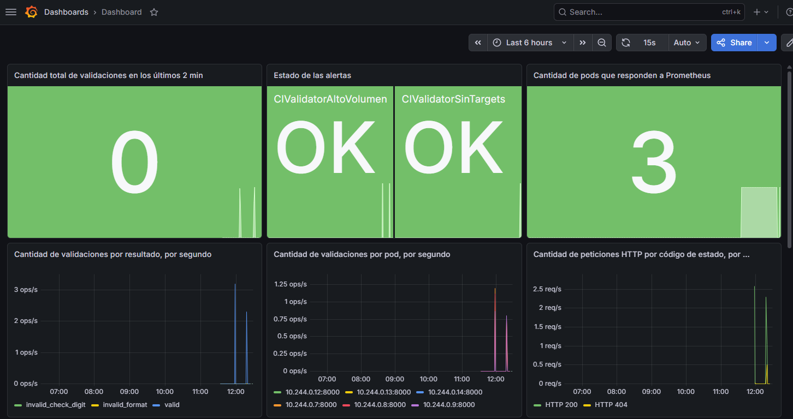

> **_Nota_** Véase que se crearon nuevos pods porque los viejos se eliminaron.