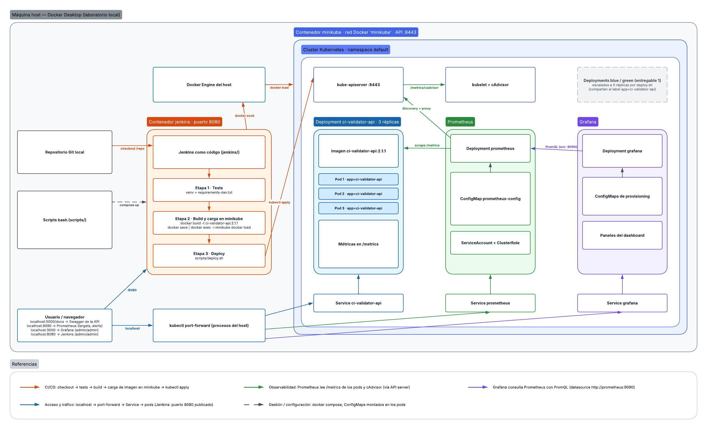
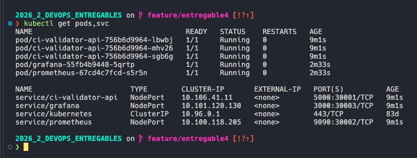
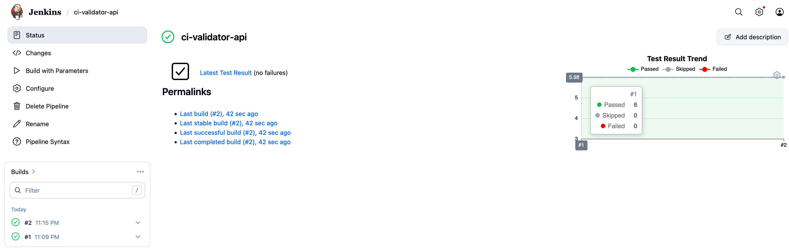
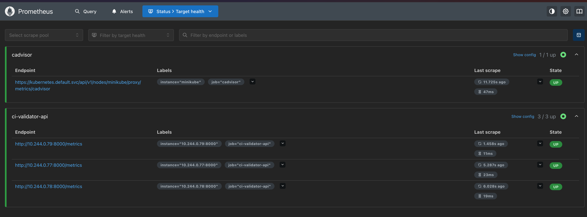
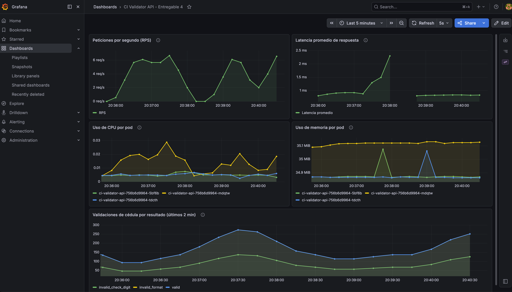
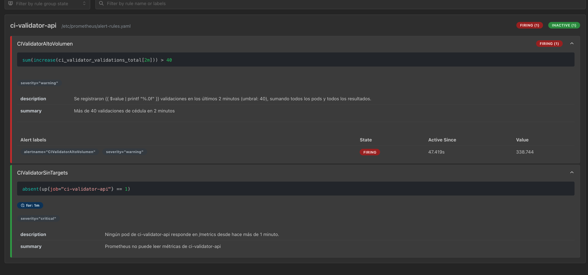

# Entregable 4 - Trabajo integrador (Jenkins, Prometheus y Grafana) y Reporte Técnico Final

Este README es el **reporte técnico final** del proyecto. Cada sección incluye capturas o fragmentos de salida de las herramientas. El dashboard de Grafana exportado está en [`dashboard/dashboard.json`](./dashboard/dashboard.json).

## Índice

- [a. Descripción general del proyecto](#a-descripción-general-del-proyecto)
- [b. Arquitectura final](#b-arquitectura-final)
- [c. Pipeline implementado](#c-pipeline-implementado)
- [d. Métricas y dashboard de Grafana](#d-métricas-y-dashboard-de-grafana)
- [e. Resultados de análisis de seguridad](#e-resultados-de-análisis-de-seguridad)
- [f. Problemas encontrados y soluciones adoptadas](#f-problemas-encontrados-y-soluciones-adoptadas)
- [g. Conclusiones y oportunidades de mejora](#g-conclusiones-y-oportunidades-de-mejora)
- [Guía paso a paso: levantar, probar y bajar](#guía-paso-a-paso-levantar-probar-y-bajar)

## a. Descripción general

`ci-validator-api` es una API hecha con FastAPI que valida cédulas de identidad uruguayas. Recibe un número, calcula el dígito verificador e indica si la cédula es válida. No guarda estado.

En cada entregable se le agregó una práctica DevOps:

| Entregable | ¿Qué se agregó? | Versión de la app |
|---|---|---|
| [1](../entregable1/) | Contenedor Docker y despliegue blue/green en Kubernetes | v1.0.0 (blue) y v2.0.0 (green) |
| [2](../entregable2/) | Métricas, monitoreo y alertas con Prometheus y Grafana | v2.1.0 |
| [3](../entregable3/) | Seguridad del código, las dependencias, la imagen y los manifiestos; políticas con Kyverno y detección en ejecución con Falco | v2.1.0 → v2.1.1 |
| 4 (este) | Pipeline de Jenkins que prueba, construye y despliega la app, monitoreada con Prometheus y Grafana | v2.1.2 (agrega tests) |

Este entregable corre en minikube. Se levanta, se prueba y se borra con scripts (ver la [guía](#guía-paso-a-paso-levantar-probar-y-bajar)).

| Endpoint | Descripción |
|---|---|
| `GET /ci/{number}` | Valida la cédula (con o sin puntos y guion) |
| `GET /health` | Estado de la API; lo usa la readinessProbe |
| `GET /metrics` | Métricas para Prometheus |

### Estructura del repositorio

```text
   .                                   # Raíz del repositorio
   ├── ci-validator-api/
   │   ├── v1.0.0 ... v2.1.1/          # Código fuente y Dockerfile de cada versión
   │   └── v2.1.2/                     # Versión usada aquí: código, Dockerfile, requirements(-dev).txt, pytest.ini y tests/
   ├── entregable1/ ... entregable3/   # Entregables anteriores (este reutiliza parte de entregable2/k8s/)
   └── entregable4/
       ├── Jenkinsfile                 # Pipeline: Tests -> Build y carga en minikube -> Deploy
       ├── dashboard/dashboard.json    # Dashboard de Grafana exportado
       ├── jenkins/                    # Dockerfile, docker-compose.yml, plugins.txt y casc.yaml
       ├── k8s/                        # App (imagen 2.1.2), Prometheus (+cAdvisor) y Grafana (provisionado)
       ├── scripts/                    # init, start-components, generate-traffic, cleanup y deploy
       └── images/entregable4/         # Diagrama y capturas
```

## b. Arquitectura final



Todo corre en la máquina local, sobre Docker Desktop:

- **Jenkins** corre en un contenedor, fuera del clúster.
  - Construye la imagen con el Docker del host, cuyo socket tiene montado.
  - Carga la imagen en el nodo de minikube con `docker exec -i minikube docker load`.
  - Llega al API server por la red Docker `minikube`, con un kubeconfig que apunta a la IP de minikube.
- **La app** es un Deployment de 3 réplicas detrás del Service `ci-validator-api`.
- **Prometheus** descubre los pods de la app por la etiqueta `app=ci-validator-api` y lee su `/metrics`. También lee el uso de CPU y memoria de los contenedores (cAdvisor) a través del API server. Para eso, su ServiceAccount tiene un ClusterRole con permisos sobre `nodes` y `nodes/proxy`.
- **Grafana** arranca con el datasource y el dashboard ya cargados (*provisioning* con ConfigMaps).
- Desde el host, a la app, Prometheus y Grafana se entra con `kubectl port-forward`. Jenkins publica el puerto 8080.

| Componente | Imagen | Puerto en localhost |
|---|---|---|
| App | `ci-validator-api:2.1.2` | 5000 (Swagger en `/docs`) |
| Prometheus | `prom/prometheus:v3.15.0` | 9090 |
| Grafana | `grafana/grafana:13.0` | 3000 |
| Jenkins | `jenkins/jenkins:lts-jdk17` + Docker CLI, kubectl y Python | 8080 |

> **_Nota_** Este entregable reutiliza manifiestos del entregable 2: el Service de la app, Prometheus y el Service de Grafana. Encima aplica los suyos, que reemplazan los recursos con el mismo nombre. Los Deployments blue/green del entregable 1 se escalan a 0, porque comparten la etiqueta `app=ci-validator-api` con la app.



*`kubectl get pods,svc`: 3 pods de la app, Prometheus y Grafana en `Running`.*

## c. Pipeline

Está definido en el [`Jenkinsfile`](./Jenkinsfile). Tiene un parámetro, `VERSION` (por defecto `2.1.2`), que elige la carpeta `ci-validator-api/v<VERSION>` y el tag de la imagen.

| Etapa | Qué hace | Herramientas |
|---|---|---|
| 1. Tests | Crea un entorno virtual, instala `requirements-dev.txt` y corre 6 tests: `/health`, cédulas válidas de 7 y 8 dígitos, dígito verificador incorrecto, formato inválido y `/metrics`. Publica el resultado en Jenkins. | Python, pytest, plugin JUnit |
| 2. Build y carga en minikube | Construye `ci-validator-api:<VERSION>` y la carga en el nodo de minikube | Docker CLI |
| 3. Deploy | Ejecuta [`scripts/deploy.sh`](./scripts/deploy.sh): crea el ConfigMap del dashboard, aplica los manifiestos, reinicia Prometheus y Grafana y espera a que todo esté listo | kubectl |

- Jenkins se configura como código. [`jenkins/casc.yaml`](./jenkins/casc.yaml) crea el usuario `admin` y el job `ci-validator-api`. Los plugins están en [`jenkins/plugins.txt`](./jenkins/plugins.txt).
- El job lee el repositorio local (`file:///repo`, rama `main`): solo ve lo commiteado en `main`.
- El pipeline se ejecuta a mano, sin webhook. La primera vez se usa *Build Now*, porque Jenkins conoce el parámetro `VERSION` recién después de una ejecución. Desde la segunda vez se usa *Build with Parameters*.



*Job `ci-validator-api`: builds #1 y #2 exitosos, con 6 tests pasados y 0 fallidos.*

## d. Métricas y dashboard de Grafana

Estas son las métricas propias de la app, en `/metrics`. Las peticiones a `/health` y `/metrics` no se cuentan como tráfico.

| Métrica | Tipo | Para qué |
|---|---|---|
| `ci_validator_validations_total{result}` | Counter | **Métrica de negocio:** validaciones por resultado (`valid`, `invalid_check_digit`, `invalid_format`) |
| `ci_validator_http_requests_total{method,route,status}` | Counter | Tráfico y errores |
| `ci_validator_http_request_duration_seconds{method,route}` | Histogram | Latencia |
| `ci_validator_http_requests_in_progress{method,route}` | Gauge | Saturación |

Prometheus también lee de cAdvisor el uso de CPU y memoria de cada pod.

**Dashboard exportado:** [`dashboard/dashboard.json`](./dashboard/dashboard.json) ("CI Validator API - Entregable 4"; se refresca cada 10 s).

- Grafana lo carga solo al arrancar.
- Para usarlo en otro Grafana: *Dashboards → New → Import*. Necesita un datasource de Prometheus con UID `prometheus`.

| Panel | Consulta PromQL |
|---|---|
| Peticiones por segundo (RPS) | `sum(rate(ci_validator_http_requests_total[1m]))` |
| Latencia promedio de respuesta | `sum(rate(ci_validator_http_request_duration_seconds_sum[1m])) / sum(rate(ci_validator_http_request_duration_seconds_count[1m]))` |
| Uso de CPU por pod | `sum(rate(container_cpu_usage_seconds_total{pod=~"ci-validator-api-.*",container=""}[1m])) by (pod)` |
| Uso de memoria por pod | `sum(container_memory_working_set_bytes{pod=~"ci-validator-api-.*",container=""}) by (pod)` |
| Validaciones por resultado (últimos 2 min) | `sum(increase(ci_validator_validations_total[2m])) by (result)` |

> **_Nota_** En este minikube, cAdvisor publica las series por pod, sin la etiqueta `container`. Por eso los paneles de CPU y memoria filtran con `container=""`.

**Alertas** (reglas de Prometheus). Se ven en http://localhost:9090/alerts. No hay Alertmanager, así que no se envían notificaciones.

| Alerta | Se dispara cuando | Consulta | Severidad |
|---|---|---|---|
| `CIValidatorAltoVolumen` | Hay más de 40 validaciones en 2 minutos | `sum(increase(ci_validator_validations_total[2m])) > 40` | warning |
| `CIValidatorSinTargets` | Ningún pod responde en `/metrics` durante 1 minuto | `absent(up{job="ci-validator-api"} == 1)` | critical |



*Targets de Prometheus: `cadvisor` (1/1) y `ci-validator-api` (3/3) en `UP`.*



*Los cinco paneles con datos después de ejecutar `generate-traffic.sh`.*



*`CIValidatorAltoVolumen` disparada (unas 339 validaciones en 2 minutos) y `CIValidatorSinTargets` inactiva.*

## e. Seguridad

El análisis se hizo en el [entregable 3](../entregable3/), sobre v2.1.0 (línea base) y v2.1.1 (con las correcciones). La v2.1.2 usa el mismo Dockerfile y las mismas dependencias que v2.1.1. Solo agrega tests, que no entran en la imagen. Por eso los resultados de la imagen también valen para la versión que despliega este entregable.

| Herramienta | Qué revisa | Línea base | Final |
|---|---|---|---|
| Semgrep 1.184.0 | Código y Dockerfile | 1 hallazgo: el contenedor corre como root (falta `USER`) | 0 hallazgos |
| pip-audit 2.10.1 | Paquetes Python instalados en la imagen | 6 vulnerabilidades, todas en pip 25.0.1 | 0 |
| Trivy 0.76.2 | Paquetes de Debian de la imagen | 189 (49 HIGH, 0 CRITICAL) | 186 (47 HIGH, 0 CRITICAL) |
| Trivy 0.76.2 | Paquetes Python de la imagen | 6 (0 HIGH, 0 CRITICAL) | 9 (5 HIGH, 1 CRITICAL) |
| KubeLinter 0.8.3 | Manifiestos de Kubernetes | 3 hallazgos (Deployment del entregable 2) | 0 (Deployment del entregable 3) |
| Kyverno | Recursos que entran al clúster | — | 3 políticas en modo `Deny`; rechazó los 7 intentos no conformes |
| Falco | Comportamiento en ejecución | — | Detectó una shell abierta dentro de un pod |

- **Corregido:**
  - El usuario root: la imagen ahora corre con un usuario sin privilegios.
  - pip: de 25.0.1 a 26.2.0.
  - `zlib1g`, la única librería de Debian con corrección publicada (2 HIGH y 1 MEDIUM).
- **Documentado:**
  - Las 47 HIGH de Debian no tienen corrección publicada.
  - Las 5 HIGH y la CRITICAL de Python están en librerías que pip trae copiadas dentro de sí (por ejemplo, `certifi`). La app no las usa en ejecución, y desaparecerían si se quitara pip de la imagen final.
- **Pendiente en este entregable:** el entorno integrado no aplica el endurecimiento ni las políticas del entregable 3 (ver la sección g).

### Fragmentos de salida

Semgrep ([línea base](../entregable3/reports/baseline/semgrep.txt), [final](../entregable3/reports/final/semgrep.txt)):

```text
# Línea base (v2.1.0)
    ci-validator-api/v2.1.0/Dockerfile
   ❯❯❱ dockerfile.security.missing-user.missing-user
          ❰❰ Blocking ❱❱
          By not specifying a USER, a program in the container may run as 'root'. This is a security hazard.
Ran 296 rules on 3 files: 1 finding.

# Final (v2.1.1)
Ran 296 rules on 3 files: 0 findings.
```

pip-audit ([línea base](../entregable3/reports/baseline/pip-audit.txt), [final](../entregable3/reports/final/pip-audit.txt)):

```text
# Línea base (v2.1.0): una de las 6 vulnerabilidades de pip
pip  25.0.1  PYSEC-2026-1796 26.0         CVE-2026-1703, GHSA-6vgw-5pg2-w6jp  When pip is installing and extracting a maliciously crafted wheel archive, files may be extracted outside the installation directory. ...

# Final (v2.1.1)
No known vulnerabilities found
```

Trivy ([línea base](../entregable3/reports/baseline/trivyreport.txt), [final](../entregable3/reports/final/trivyreport.txt)):

```text
# Final (v2.1.1)
entregable3/build/ci-validator-api-2.1.1.tar (debian 13.7)
Total: 186 (UNKNOWN: 0, LOW: 65, MEDIUM: 74, HIGH: 47, CRITICAL: 0)

Python (python-pkg)
Total: 9 (UNKNOWN: 0, LOW: 1, MEDIUM: 2, HIGH: 5, CRITICAL: 1)
```

KubeLinter ([línea base](../entregable3/reports/baseline/kubelinter.txt), [final](../entregable3/reports/final/kubelinter.txt)):

```text
# Línea base (entregable 2): uno de los 3 hallazgos
/repo/entregable2/k8s/app/deployment.yaml: (object: <no namespace>/ci-validator-api apps/v1, Kind=Deployment) container "ci-validator-api-container" is not set to runAsNonRoot (check: run-as-non-root, ...)

# Final (entregable 3)
No lint errors found!
```

Kyverno ([validación completa](../entregable3/reports/final/kyverno-validation.txt)):

```text
=== kubectl apply -f entregable3/k8s/non-compliant/04-root.yaml ===
Error from server: error when creating "entregable3/k8s/non-compliant/04-root.yaml": admission webhook "vpol.validate.kyverno.svc-fail" denied the request: Policy disallow-root-containers failed: securityContext.runAsNonRoot debe ser true (en el pod o en cada contenedor) y no puede ser false en el pod. No cumplen: app
```

Falco ([evento completo](../entregable3/reports/final/falco-event.txt)), regla *Terminal shell in container*:

```text
17:51:11.754347136: Notice A shell was spawned in a container with an attached terminal | evt_type=execve user=<NA> user_uid=100 ... process=sh proc_exepath=/usr/bin/dash parent=containerd-shim command=sh terminal=34816 ... k8s_pod_name=ci-validator-api-57b864cdf9-6vwqd k8s_ns_name=default
```

## f. Problemas encontrados y soluciones adoptadas

### Entregable 4

| Problema | Causa | Solución |
|---|---|---|
| Jenkins no llegaba al clúster | El kubeconfig de minikube apunta a `127.0.0.1`, que dentro del contenedor de Jenkins es el propio contenedor | Kubeconfig con la IP de minikube y Jenkins conectado a la red Docker `minikube` (`start-components.sh`) |
| No se podía cargar la imagen en minikube desde Jenkins | El contenedor de Jenkins no tiene el CLI de minikube | `docker save \| docker exec -i minikube docker load` |
| `docker: not found` en la etapa de build | En Debian 13, el paquete `docker.io` ya no incluye el binario `docker` | Instalar `docker-cli` en `jenkins/Dockerfile` |
| Jenkins rechazaba el checkout de `file:///repo` | El plugin de Git bloquea los repositorios locales | `-Dhudson.plugins.git.GitSCM.ALLOW_LOCAL_CHECKOUT=true` |
| El pipeline fallaba con un `Jenkinsfile` vacío | El job solo ve lo commiteado en `main` | Commitear en `main` antes de ejecutarlo |
| `buildWithParameters` devolvía 400 la primera vez | Jenkins conoce los parámetros del `Jenkinsfile` recién después de una ejecución | Primera ejecución con *Build Now* |
| `container name "/jenkins" is already in use` | Ya existía otro contenedor llamado `jenkins` | Renombrarlo o borrarlo (`docker rename` / `docker rm`) |
| Los paneles de CPU y memoria salían vacíos | cAdvisor publica las series por pod, sin etiqueta `container`, y el filtro `container!=""` las descartaba | Filtrar con `container=""` |
| Métricas en 0 y respuestas de versiones viejas | Los Deployments blue/green del entregable 1 comparten la etiqueta `app=ci-validator-api`: el Service y Prometheus mezclaban sus pods con los de v2.1.2 | `deploy.sh` los escala a 0 |
| Los `localhost:<puerto>` dejaban de responder | `kubectl port-forward` se corta cuando el pod se reinicia (por ejemplo, después de un deploy) | Bucle de reintento por servicio en `start-components.sh` |
| Prometheus y Grafana no tomaban los cambios de configuración | Los ConfigMaps montados no se recargan solos | `deploy.sh` hace `rollout restart` de ambos |

### Entregables anteriores

| Entregable | Problema | Causa | Solución |
|---|---|---|---|
| 1 | Después del `patch` del Service, el tráfico seguía llegando a blue | `kubectl port-forward` elige un pod al arrancar y no sigue los cambios del selector | Usar `minikube service --url`, que entra por el NodePort y respeta el selector |
| 2 | Grafana se reiniciaba (`OOMKilled`) | El límite de memoria (512Mi) era menor que su pico de arranque | Límite de 1Gi |
| 3 | Kyverno no se instalaba en minikube | Resolución de nombres (DNS) de Docker Desktop | Agregar `"dns": ["1.1.1.1", "8.8.8.8"]` en la configuración de Docker Engine |
| 3 | Pods en `CreateContainerConfigError` con `runAsNonRoot: true` | La imagen declara el usuario por nombre (`appuser`) y el kubelet no puede comprobar que no sea root | UID y GID numéricos (100 y 101) en el Deployment |
| 3 | Las políticas de Kyverno rechazarían el DaemonSet de Falco | Falco necesita correr con privilegios | Excluir los namespaces `kube-system`, `kyverno` y `falco` de las políticas |

## g. Conclusiones y oportunidades de mejora

### Conclusiones

- Se logró un flujo completo y repetible: un cambio commiteado se prueba, se empaqueta, se despliega y queda monitoreado, con dashboard y alertas. Todo está escrito como código (Jenkinsfile, configuración de Jenkins, manifiestos y dashboard), y se levanta y se borra con scripts.
- Lo más difícil no fue la app sino el entorno: la red entre contenedores (Jenkins y minikube), el comportamiento de `kubectl port-forward`, las etiquetas compartidas entre despliegues y las etiquetas de cAdvisor. La mayoría de los problemas de la sección f son de ese tipo.
- El monitoreo sirvió para detectar errores de despliegue: las métricas en 0 revelaron que el Service mezclaba pods de versiones viejas.
- En seguridad, se corrigió todo lo que tenía corrección publicada y se documentó el resto. Las 186 vulnerabilidades sin corrección de la imagen base muestran que elegir la imagen base también es una decisión de seguridad.
- La debilidad principal es que la seguridad quedó separada del flujo. El pipeline no corre los análisis del entregable 3, y este entorno no aplica su endurecimiento ni sus políticas: hoy el pipeline desplegaría una imagen vulnerable sin avisar.

### Limitaciones del estado actual

- El Deployment usa siempre la imagen `ci-validator-api:2.1.2`.
  - Si cambia el código pero no el tag, los pods no se reinician y siguen con la imagen anterior.
  - El parámetro `VERSION` cambia lo que se construye, pero no lo que se despliega.
  - Además, solo v2.1.2 tiene tests, así que en la práctica el pipeline sirve solo para esa versión.
- No hay prueba después del deploy (smoke test) ni vuelta atrás automática.
- Los tests corren con el Python del contenedor de Jenkins, no dentro de la imagen que se despliega.
- La app y Grafana no definen `resources`, y la app no tiene `livenessProbe`.
- Jenkins corre como root con el socket de Docker del host, y Jenkins y Grafana usan `admin` / `admin`.
- Prometheus y Grafana no guardan datos entre reinicios, y las alertas no notifican a nadie.
- Algunas versiones no están fijadas: la imagen de Jenkins (`lts-jdk17`), kubectl (`stable`) y, en el entregable 3, Kyverno, Helm y Falco.

### Oportunidades de mejora

1. Agregar una etapa de seguridad al pipeline (Semgrep, pip-audit, Trivy y KubeLinter). Debería cortar el despliegue ante vulnerabilidades HIGH o CRITICAL con corrección disponible, por ejemplo con `trivy image --severity HIGH,CRITICAL --ignore-unfixed --exit-code 1`.
2. Desplegar con los manifiestos endurecidos del entregable 3 y con Kyverno activo, también en el entorno del pipeline.
3. Mejorar cómo se publica cada versión:
   - Usar un tag distinto por build (número de build o hash del commit).
   - Correr los tests dentro de la imagen.
   - Agregar un smoke test.
   - Llevar el blue/green del entregable 1 al pipeline, con vuelta atrás automática si la prueba falla.
4. Publicar las imágenes en un registry en lugar de cargarlas en el nodo, y disparar el pipeline con un webhook.
5. Agregar Alertmanager con notificaciones (correo o Slack), persistencia para Prometheus y Grafana, y credenciales en Secrets.
6. Achicar la imagen: build multi-etapa sin pip y una imagen base mínima. Así se eliminan las 9 vulnerabilidades de las librerías internas de pip y se reducen las de Debian.
7. A futuro, pasar a GitOps (por ejemplo, con Argo CD), para que el clúster se sincronice solo desde Git.

---

## Guía paso a paso: levantar, probar y bajar

### Requisitos

- Docker Desktop (corriendo), minikube y kubectl.
- bash, ejecutando todo desde la raíz del repositorio.
- Un minikube sin las políticas de Kyverno del entregable 3: ejecutar `minikube delete --all --purge` antes de empezar.
- Los cambios commiteados en la rama `main`, porque el job de Jenkins lee el repositorio local.
- Los puertos 3000, 5000, 8080 y 9090 libres, y ningún otro contenedor llamado `jenkins`.

### 1. Levantar

```bash
./entregable4/scripts/init.sh
```

Arranca minikube (si no estaba) y habilita `metrics-server`. Construye la imagen `ci-validator-api:2.1.2`, la carga en minikube y despliega la app (3 réplicas), Prometheus y Grafana.

```bash
./entregable4/scripts/start-components.sh
```

Levanta Jenkins y abre los port-forward. Si un port-forward se cae, se reintenta solo; cada reintento queda registrado en `$TMPDIR/ci-validator-portforward.log`.

| Componente | URL | Usuario |
|---|---|---|
| App (Swagger) | http://localhost:5000/docs | — |
| Prometheus | http://localhost:9090/targets | — |
| Grafana | http://localhost:3000 | admin / admin |
| Jenkins | http://localhost:8080 | admin / admin |

### 2. Probar

1. **Pipeline:** en Jenkins, abrir el job `ci-validator-api` y usar *Build Now* la primera vez (después, *Build with Parameters*). Las 3 etapas deben terminar en verde.
2. **Tráfico:**

   ```bash
   ./entregable4/scripts/generate-traffic.sh [rondas=60] [pausa_seg=0.5]
   ```

   Envía cédulas válidas, con dígito verificador incorrecto y mal formadas: 5 por ronda, unos 40 s con los valores por defecto. Así se superan las 40 validaciones en 2 minutos y se dispara la alerta.
3. **Verificar:**

| Qué | Dónde | Resultado esperado |
|---|---|---|
| Pods | `kubectl get pods` | 3 × `ci-validator-api`, `prometheus` y `grafana` en `Running` |
| Targets | http://localhost:9090/targets | `ci-validator-api` (3/3) y `cadvisor` (1/1) en `UP` |
| Alerta | http://localhost:9090/alerts | `CIValidatorAltoVolumen` en `Firing` |
| Dashboard | Grafana → "CI Validator API - Entregable 4" | Los 5 paneles con datos |
| Pipeline | Jenkins → job `ci-validator-api` | Build exitoso y 6 tests pasados |

### 3. Bajar todo

```bash
./entregable4/scripts/cleanup.sh          # port-forwards, Jenkins (con su volumen) y recursos de Kubernetes
./entregable4/scripts/cleanup.sh --all    # además, borra el clúster de minikube
```

### Problemas frecuentes

- **"container name /jenkins is already in use":** existe otro contenedor llamado `jenkins`. Renombrarlo (`docker rename jenkins <otro>`) o borrarlo (`docker rm jenkins`).
- **Un `localhost:<puerto>` no responde:** el port-forward se está reiniciando; después de un deploy tarda unos segundos. Si sigue sin responder, volver a ejecutar `start-components.sh`.
- **El pipeline falla con el `Jenkinsfile` vacío o sin `scripts/`:** faltan commits en `main`.

---

## Capturas de pantalla

Imágenes en [`./images/entregable4/`](./images/entregable4/).

### 1. Pods y servicios en Kubernetes
`kubectl get pods,svc` con la app ×3, Prometheus y Grafana en `Running`.


### 2. Pipeline de Jenkins
Vista de etapas (Stage View) con Tests, Build y carga en minikube, y Deploy en verde, y resultado de los tests.


### 3. Targets de Prometheus
http://localhost:9090/targets con `ci-validator-api` y `cadvisor` en `UP`.


### 4. Dashboard de Grafana
Los cinco paneles con datos tras ejecutar `generate-traffic.sh`.


### 5. Alerta disparada
http://localhost:9090/alerts con `CIValidatorAltoVolumen` en `Firing`.


---